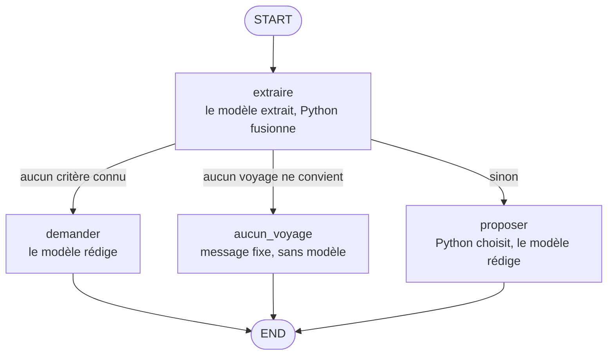

# Agent voyage

Chatbot d'agence de voyage écrit avec LangGraph. Il comprend les envies du client, choisit un voyage parmi les cinq de l'agence et le lui propose.

Projet d'examen de la formation LBKE « Framework IA agentique LangChain » (bloc RNCP37805BC03), Patrick Delias, octobre 2026.

## Liens

| | |
|---|---|
| Dépôt | https://github.com/paddock69-design/DELIAS-PATRICK-formation-langchain-lbke-examen-cpf |
| Application (Render, mode développement) | https://agent-voyage-delias.onrender.com (`/ok` pour vérifier qu'elle répond, `/docs` pour l'API) |
| Studio sur l'application | https://eu.smith.langchain.com/studio/?baseUrl=https://agent-voyage-delias.onrender.com |

L'instance Render gratuite s'endort après une période d'inactivité : la première requête peut prendre une minute.

## Ce que fait l'agent

Le sujet fixe 6 critères (`plage`, `montagne`, `ville`, `sport`, `detente`, `acces_handicap`) et 5 voyages. À chaque message du client :

1. l'agent extrait les critères que le message exprime ;
2. s'il ne connaît encore aucun critère, il en demande ;
3. sinon, il propose un voyage et invite le client à préciser ses envies.

Chaque critère vaut `None` au départ (le client n'en a rien dit), `True` pour un avis positif, `False` pour un vrai refus.

Le state garde les 6 critères, le dernier message de l'utilisateur et la dernière réponse de l'IA, comme le demande le sujet. Il n'y a pas d'historique de conversation.

Les 5 voyages, une fois traduits dans le vocabulaire des critères :

| Voyage | plage | montagne | ville | sport | detente | acces_handicap |
|---|---|---|---|---|---|---|
| Randonnée camping en Lozère | | oui | | oui | | |
| 5 étoiles à Chamonix option fondue | | oui | | | oui | oui |
| 5 étoiles à Chamonix option ski | | oui | | oui | | |
| Palavas de paillotes en paillotes | oui | | oui | | oui | oui |
| 5 étoiles en rase campagne | | | | | oui | oui |

## Architecture

Le principe : **le modèle comprend et rédige, le code décide.** Le choix du voyage est fait en Python, donc il est reproductible et se vérifie par des tests. Un modèle de langage peut se tromper ou varier d'un appel à l'autre, ce qui a été constaté plusieurs fois pendant la formation.



| Étape | Nœud | Ce qui se passe | Qui le fait |
|---|---|---|---|
| 0 | `START` | Le message du client arrive (Studio ou API) | `langgraph dev` |
| 1 | `extraire` | Extraire les critères du message, en sortie structurée | Le modèle |
| 2 | `extraire` | Fusionner avec les critères déjà connus : seuls ceux que le message cite changent | Python |
| 3 | `aiguiller` | Arête conditionnelle à trois sorties : aucun critère, aucun voyage, ou un voyage | Python |
| 4a | `demander` | Demander des critères | Le modèle rédige |
| 4b | `proposer` | Choisir le voyage | Python |
| 5b | `proposer` | Proposer le voyage et inviter à préciser | Le modèle rédige |
| 4c | `aucun_voyage` | Dire qu'aucun voyage ne correspond | Python, sans modèle |
| 6 | `END` | Les cases renvoyées par les nœuds sont écrites dans le state | LangGraph |

Le graphe est un `StateGraph` et non un `create_agent` : l'ordre des étapes est fixé par le code, pas laissé au choix du modèle.

Le code est découpé en un fichier par étape, dans `src/agent_voyage/` :

| Fichier | Rôle |
|---|---|
| `voyages.json` | Les 5 voyages, tels que le sujet les donne (syntaxe JSON corrigée seulement) |
| `voyages.py` | Traduit le JSON dans le vocabulaire des 6 critères |
| `modele.py` | Le modèle de langage, défini à un seul endroit |
| `extraction.py` | Étape 1 : le schéma `CriteresExtraits` et le prompt d'extraction |
| `choix.py` | Étapes 3 et 4b : la règle métier, en Python |
| `redaction.py` | Étapes 4a et 5b : les prompts de rédaction |
| `graph.py` | Le State, les 4 nœuds, l'aiguillage et le graphe compilé |

Ce découpage permet de tester chaque étape seule. C'est ainsi qu'ont été localisées les pannes de l'extraction, par exemple « Quelle est la capitale du Japon ? », qui donnait `ville=True` et faisait proposer Palavas.

## Les règles métier et leurs raisons

**1. Un vrai Non exclut, l'indifférence donne `None`.** Le sujet range aussi l'indifférence sous Non. L'auteur du sujet a précisé que Non est exclusif quand c'est vraiment Non. Le prompt d'extraction ne met donc `false` que pour un refus clair, et `null` pour « la plage m'est égale ». Un critère à `False` exclut tous les voyages qui l'ont.

**2. Un point par envie satisfaite, l'ordre du fichier à égalité.** Chaque `True` du client que le voyage satisfait vaut 1 point. À égalité, le premier voyage du fichier passe devant (`max` garde le premier des meilleurs). C'est une limite assumée : l'ordre du fichier favorise certains séjours, comme un vendeur qui pousse un produit.

**3. L'accès handicap est un besoin, pas un goût.** `acces_handicap=True` est un filtre strict : les voyages non accessibles sont exclus. Refuser une proposition ne l'efface pas.

**4. Aucun voyage quand rien ne convient.** Le nœud `aucun_voyage` répond quand tous les voyages sont exclus, ou quand le client a exprimé au moins une envie et qu'aucun voyage restant n'en satisfait une seule. Si le client n'a donné que des refus (« pas de plage »), l'agent propose le premier voyage non exclu : le sujet dit que l'agent propose un voyage dès qu'un critère est rempli, et un refus en est un. Avant cette règle, « pas de plage, la ville » proposait la Lozère sans aucune envie satisfaite (une panne silencieuse), et « pas de montagne, pas de détente » plantait (`ValueError` sur une liste vide).

**5. Un « non » à la proposition efface les envies qui y ont mené.** Sans cette règle, « Non, pas celui-là » ne changeait aucun critère, et l'agent reproposait Palavas : de la vente forcée. La dernière réponse de l'IA est donc donnée à l'extraction, qui signale le refus par le champ `refuse_proposition`. Ce champ n'est pas un critère et n'entre pas dans le state. Le nœud `extraire` remet alors à `None` les envies à `True`. Les refus (`False`) et le besoin `acces_handicap` restent. Option écartée : mémoriser les voyages refusés, qui demandait deux cases de plus dans un State fixé par le sujet.

**6. Le modèle ne rédige qu'à partir de faits.** La rédaction reçoit le nom du voyage et les critères qu'il possède, lus dans le fichier, ainsi que les envies du client calculées sur le state, donc sur tous les tours. Il lui est interdit d'inventer une durée, un prix, un programme ou une activité. Sans ces faits, le modèle inventait tout, jusqu'à écrire « [insérer le prix] ». Chaque consigne n'est donnée que si elle s'applique : une consigne hors de propos le pousse à inventer.

**7. Un message hors sujet ne donne aucun critère.** Un lieu cité sans envie d'y aller n'exprime aucun avis. La demande recadre poliment le client sur les voyages de l'agence, sauf s'il répond au message précédent, par exemple en refusant la proposition.

**8. Le JSON du sujet est gardé tel quel, la traduction est faite en Python.** `détente` devient `detente`, `accessibleHandicap: "oui"` devient `acces_handicap=True`, et les labels sans critère (`campagne`, `paillote`) sont ignorés. Les données de l'agence restent intactes, et un nouveau fichier de l'agence marchera encore.

**9. `temperature=0`.** Le même message donne la même extraction : 5 réponses identiques sur 5 appels. À la température par défaut, avec le même prompt, « Montpellier » donnait `plage=True` 3 fois et `plage=None` 2 fois. Les démonstrations sont donc rejouables. Ce n'est pas un déterminisme total : la formulation des réponses varie encore un peu, mais le choix du voyage, fait en Python, ne varie pas.

## Lancer en local

Prérequis : Python 3.13 et [uv](https://docs.astral.sh/uv/).

```powershell
uv sync
Copy-Item .env.example .env
```

Remplir le fichier `.env` dans l'éditeur : `OPENROUTER_API_KEY` est obligatoire, les variables LangSmith sont facultatives (elles servent aux traces).

```powershell
uv run langgraph dev --studio-url https://eu.smith.langchain.com
```

Studio s'ouvre sur le serveur local `http://127.0.0.1:2024`, avec le seul graphe `agent_voyage`. Si Studio affiche « Failed to fetch », ouvrir `http://127.0.0.1:2024/ok` : une erreur veut dire que le serveur est arrêté, il faut le relancer.

## Les tests

```powershell
uv run python -m pytest tests/unit_tests -q
```

Six tests de `choix.py`, sans aucun appel au modèle, en 0,05 seconde :

| Test | Critères du client | Résultat attendu |
|---|---|---|
| `test_montpellier_donne_palavas` | plage et ville | Palavas |
| `test_montagne_en_fauteuil_donne_chamonix_fondue` | montagne et accès handicap | Chamonix option fondue |
| `test_tous_les_voyages_exclus_donne_none` | pas de montagne, pas de détente | aucun voyage |
| `test_oui_jamais_satisfait_donne_none` | pas de plage, la ville | aucun voyage |
| `test_que_des_refus_donne_le_premier_non_exclu` | pas de plage | Lozère |
| `test_aucun_critere` | rien, puis un refus | aucun critère, puis un critère rempli (un refus en est un) |

Le sujet ne demande pas de tests. Mais la règle métier est en Python : elle se teste gratuitement, avec un résultat toujours identique. Les tests d'intégration du modèle de départ, qui appelaient le modèle, ont été retirés.

## Le déploiement sur Render

Web service Python, région Francfort, instance gratuite, redéployé automatiquement à chaque push sur `main`.

| Réglage | Valeur |
|---|---|
| Build Command | `uv sync` |
| Start Command | `uv run langgraph dev --port $PORT --host 0.0.0.0 --no-browser` |
| Variables | `PYTHON_VERSION=3.13.6`, `OPENROUTER_API_KEY`, `LANGSMITH_API_KEY`, `LANGSMITH_ENDPOINT`, `LANGSMITH_TRACING=true`, `LANGSMITH_PROJECT=examen-cpf-render` |

Les valeurs des clés sont saisies dans Render, jamais dans le dépôt. `LANGSMITH_PROJECT` est différent en local (`examen-cpf-voyage`) : les conversations sur Render et les essais locaux sont rangés dans deux projets LangSmith séparés.

`langgraph dev` est le mode développement demandé par le sujet. La mémoire est en RAM, effacée à chaque redéploiement et à chaque réveil de l'instance, et le serveur n'a pas d'authentification. Ce n'est pas un service de production.

## Changer de modèle ou de clé

- **Le modèle** : une seule ligne, `model=` dans `src/agent_voyage/modele.py`. L'extraction et la rédaction utilisent le même modèle. Il doit accepter la sortie structurée. En local, `langgraph dev` recharge le code seul ; sur Render, il faut un commit et un push.
- **La clé en local** : `OPENROUTER_API_KEY` dans `.env`, puis relancer le serveur, qui lit les variables au démarrage.
- **La clé sur Render** : menu Environment du service, modifier la valeur, enregistrer en choisissant de redéployer.

## Les clés d'API

- Le fichier `.env` est exclu de git (`.gitignore`). Seul `.env.example`, sans aucune valeur, est dans le dépôt.
- L'application déployée utilise une clé OpenRouter dédiée, plafonnée à 2 dollars et limitée dans le temps, distincte de la clé de développement. Si elle fuit, la perte est plafonnée.
- Render n'a accès, dans GitHub, qu'aux dépôts de la formation.

## Les dépendances

Quatre dépendances directes, figées avec toutes leurs sous-dépendances dans `uv.lock`, et une version de Python fixée par `.python-version` :

| Paquet | Rôle |
|---|---|
| `langchain` | `init_chat_model` et `with_structured_output` |
| `langchain-openai` | le client du modèle : OpenRouter parle l'API d'OpenAI |
| `langgraph` | `StateGraph`, les nœuds et les arêtes |
| `python-dotenv` | lecture d'un fichier `.env`, héritée du modèle de départ (aucun import direct dans `src/`) |

Pour le développement : `langgraph-cli[inmem]` (le serveur `langgraph dev`), `pytest`, `ruff`, `anyio`.

Le dépôt est parti du modèle de la formation, `lbke/langgraph-simple-agent-openrouter`. Ses agents de démonstration et la dépendance `fastmcp` ont été retirés : 42 paquets de moins à installer à chaque déploiement.

## Les limites assumées

- **Pas d'historique de conversation**, comme le prévoit le sujet : l'agent ne voit que le dernier échange et les critères.
- **Après un refus de la proposition, les envies sont oubliées** : le client doit les redire.
- **L'ordre du fichier départage** deux voyages à égalité.
- **L'extraction peut varier** sur un message ambigu, même à `temperature=0` : le prompt oriente le modèle, il ne le commande pas. Le choix du voyage, fait en Python, absorbe la plupart de ces écarts.
- **Pas de gestion des injections ni des hallucinations**, que le sujet ne demande pas, au-delà des consignes de rédaction.
- **Render gratuit** : réveil lent, mémoire effacée au réveil.
- **`openai/gpt-4o-mini` sera retiré par OpenRouter le 14/01/2027** : une ligne à changer dans `modele.py`.
